<p align="center">
  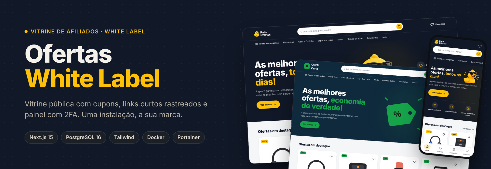
</p>

<h1 align="center">🛍️ Ofertas White Label — Vitrine de Afiliados com Painel Seguro</h1>

<p align="center">
  <strong>Uma vitrine pública de ofertas e cupons com links curtos rastreados, painel administrativo com 2FA e identidade visual 100% configurável. Uma instalação, a sua marca.</strong>
</p>

<p align="center">
  <a href="https://nextjs.org/"></a>
  <a href="https://www.postgresql.org/"></a>
  <a href="https://tailwindcss.com/"></a>
  <a href="https://www.portainer.io/"></a>
  <a href="#-licenciamento-e-termos-de-uso"></a>
</p>

<p align="center">
  <a href="https://github.com/jmarquesneto/ofertas_whitelabel/actions/workflows/docker.yml"></a>
  <a href="https://github.com/jmarquesneto/ofertas_whitelabel/pkgs/container/ofertas_whitelabel"></a>
</p>

---

## 💡 A ideia

Quem divulga ofertas de afiliados (Shopee, Mercado Livre, Amazon, Magalu, AliExpress…) normalmente sofre com três coisas: **links gigantes e feios**, **nenhuma noção de quais ofertas realmente geram cliques** e **sites engessados numa única marca**.

O **Ofertas White Label** resolve as três de uma vez:

1. **Links curtos no seu domínio** (`seusite.com/fone-bluetooth`) que registram o clique e redirecionam para o link de afiliado, sem expor o link bruto.
2. **Analytics de verdade**: cliques por oferta, por dia e visitantes únicos, filtrando robôs e prévias de WhatsApp/Telegram.
3. **White label real**: nome, logo, favicon, cores e aviso legal ficam no banco. Troque no painel e a vitrine muda na hora, **sem rebuild e sem mexer em código**.

E roda em qualquer servidor caseiro: uma imagem Docker pronta, pensada para **OpenMediaVault + Portainer**.

---

## 📸 Galeria

<p align="center">
  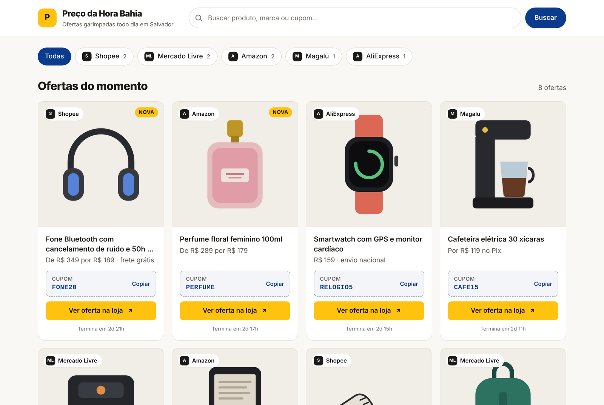
  <br>
  <em>Home: hero configurável com mascote, ofertas em destaque com preço "de/por" e % de desconto, cupom copiável e favoritos.</em>
</p>

<br>

<p align="center">
  
  <br>
  <em>White label: a mesma instalação com duas identidades. O texto dos botões fica branco ou escuro sozinho, conforme o contraste da cor.</em>
</p>

<br>

<table align="center" width="100%">
  <tr>
    <td width="50%" align="center" valign="top">
      <strong>🗂️ Categorias e filtros</strong><br><br>
      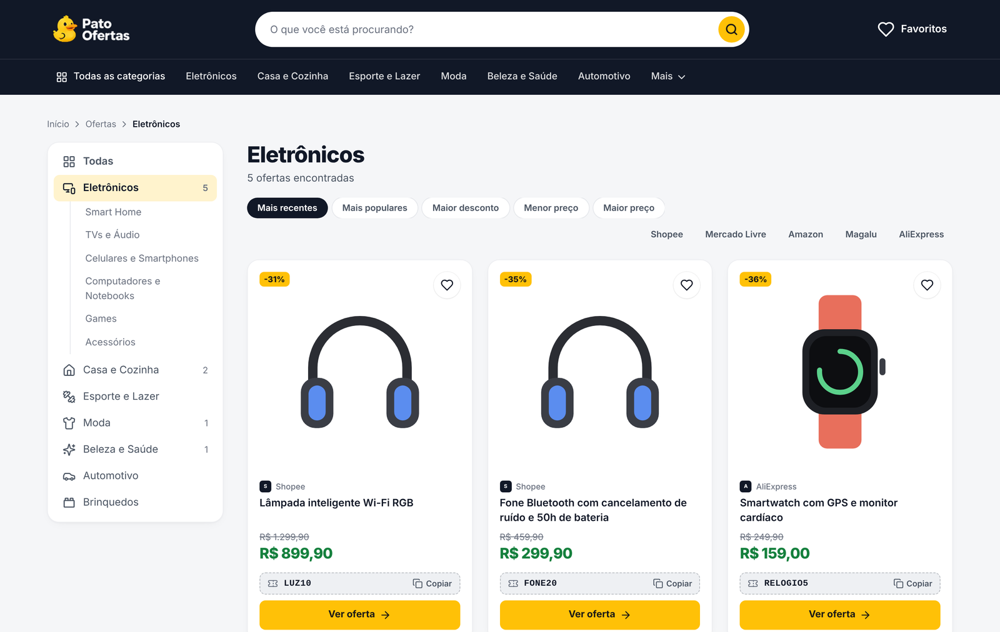
      <br><em>Categorias com subcategorias, ordenação (populares, maior desconto, menor preço) e filtro por loja.</em>
    </td>
    <td width="50%" align="center" valign="top">
      <strong>🛍️ Página da oferta</strong><br><br>
      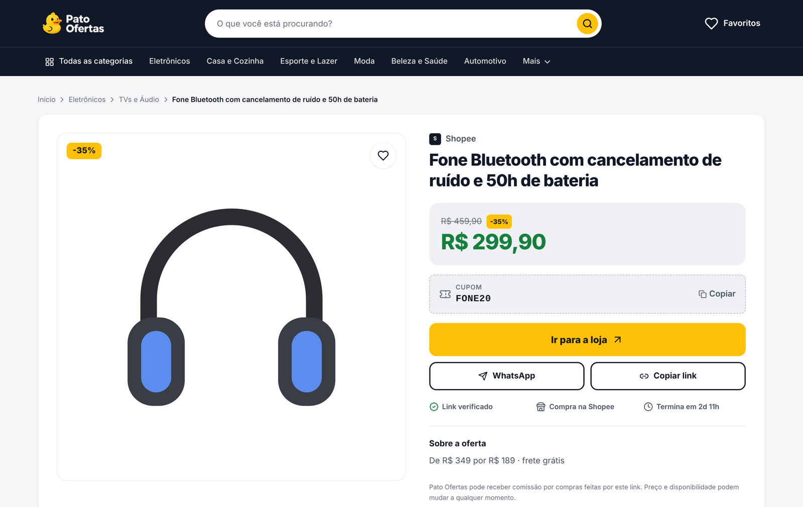
      <br><em>Prévia bonita no WhatsApp/Telegram, botão "Ir para a loja" (clique contado) e compartilhamento com texto pronto.</em>
    </td>
  </tr>
  <tr>
    <td width="50%" align="center" valign="top">
      <strong>📊 Analytics de cliques</strong><br><br>
      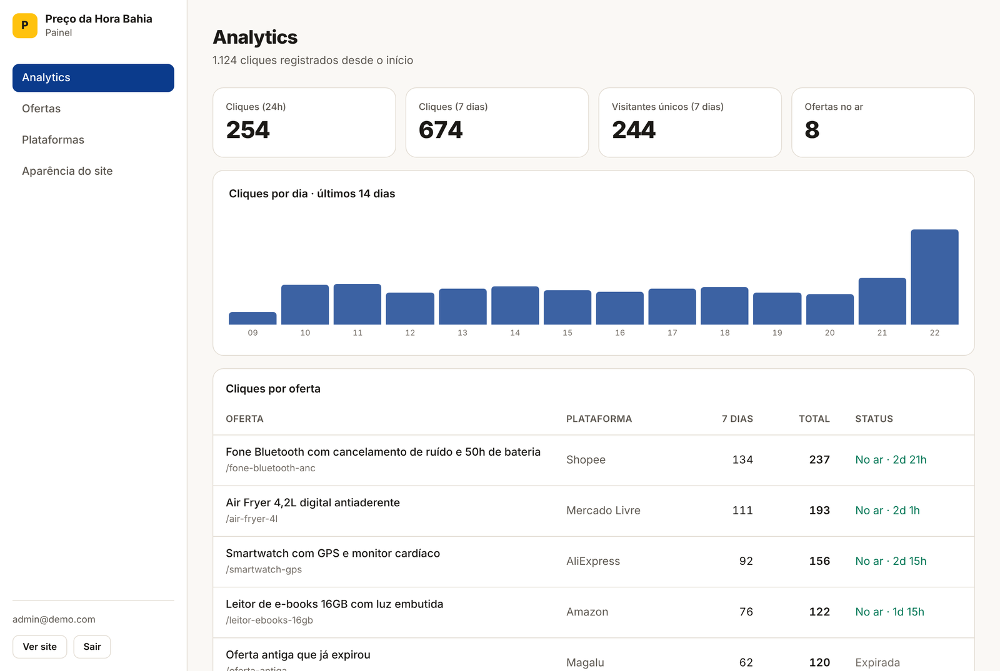
      <br><em>Cliques em 24h e 7 dias (com tendência), visitantes únicos, gráfico diário e ranking.</em>
    </td>
    <td width="50%" align="center" valign="top">
      <strong>🏷️ Gestão de ofertas</strong><br><br>
      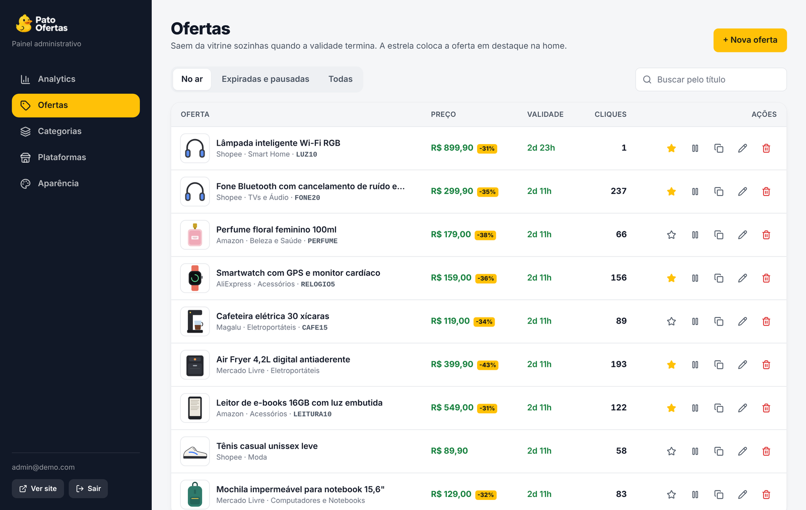
      <br><em>Destacar na home, pausar, renovar por 72h, duplicar, editar e excluir com um clique.</em>
    </td>
  </tr>
  <tr>
    <td width="50%" align="center" valign="top">
      <strong>✍️ Cadastro com prévia do card</strong><br><br>
      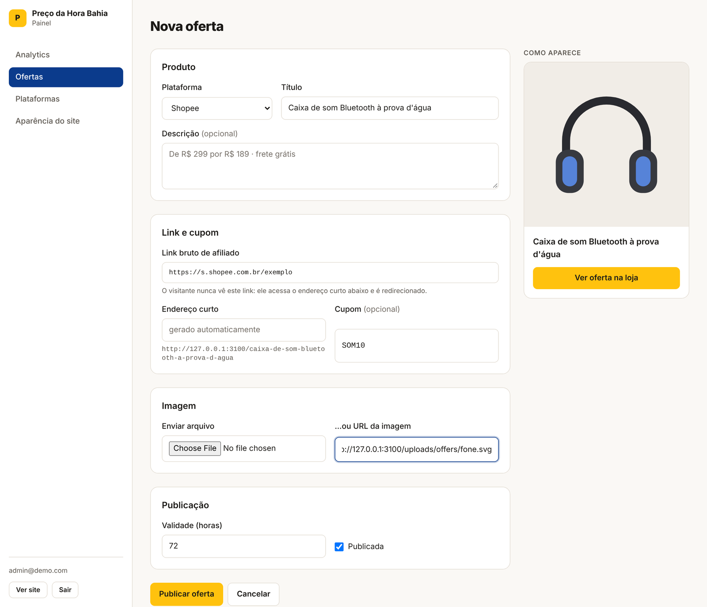
      <br><em>Preço "de/por" com desconto calculado ao vivo, categoria, cupom, imagem por upload ou URL.</em>
    </td>
    <td width="50%" align="center" valign="top">
      <strong>🎨 Aparência do site</strong><br><br>
      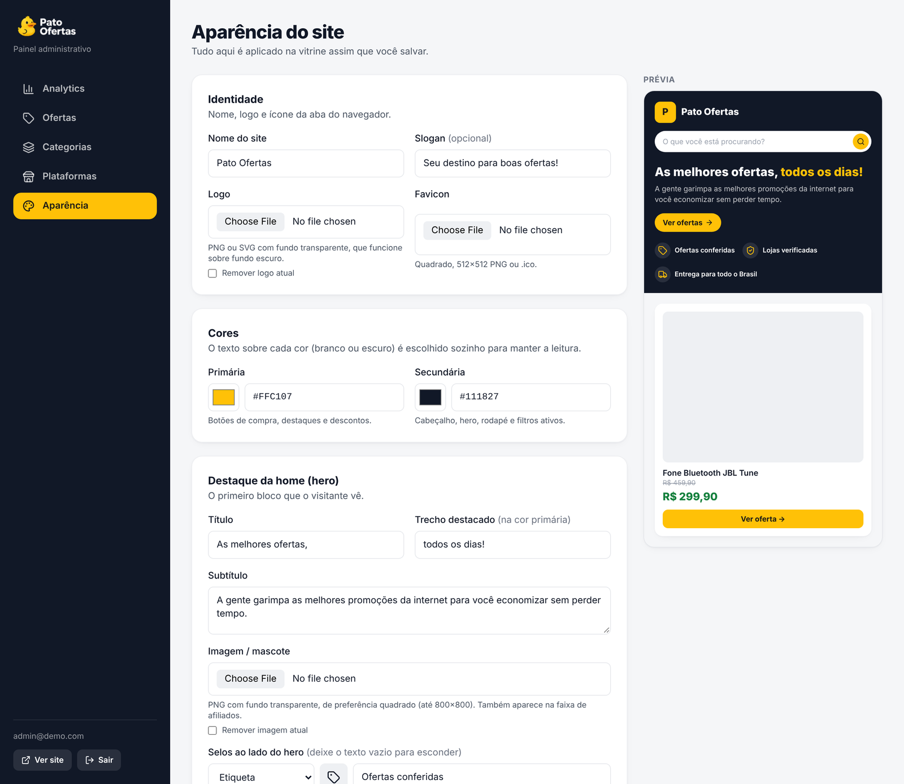
      <br><em>Logo, cores, hero (título, mascote, selos), faixa de afiliados e aviso legal, com prévia ao vivo.</em>
    </td>
  </tr>
  <tr>
    <td colspan="2" align="center" valign="top">
      <strong>🖼️ Banners do topo</strong><br><br>
      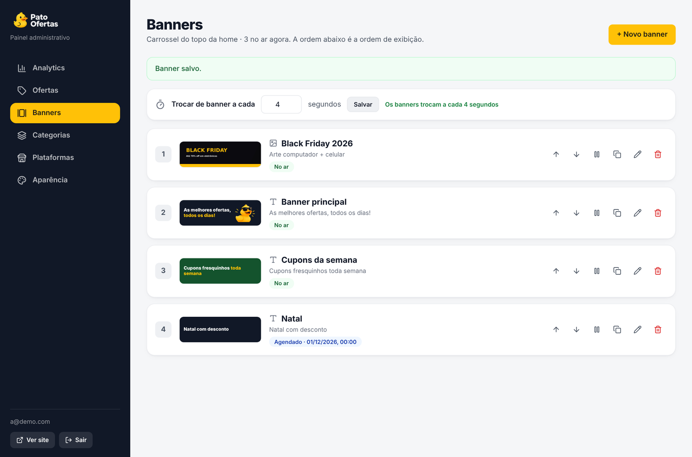
      <br><em>Carrossel com banners de texto ou arte pronta (computador + celular), ordem, pausa, agendamento e tempo de troca.</em>
    </td>
  </tr>
  <tr>
    <td width="50%" align="center" valign="top">
      <strong>🗃️ Categorias</strong><br><br>
      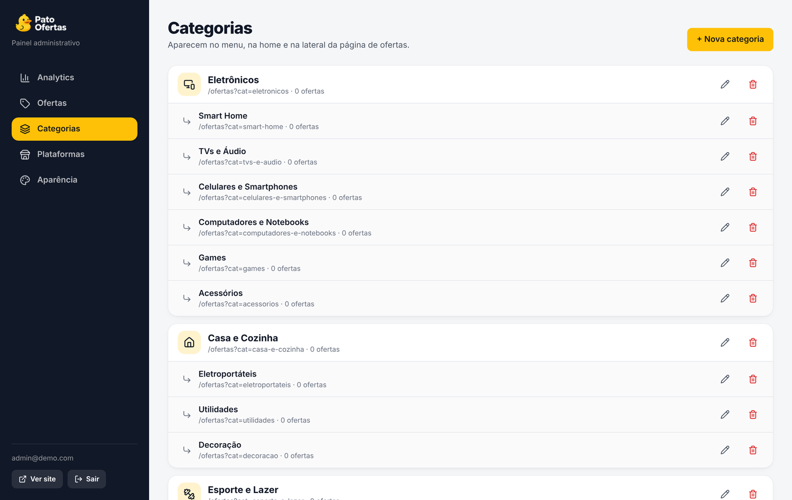
      <br><em>Dois níveis (categoria → subcategoria), com ícone e ordem no menu.</em>
    </td>
    <td width="50%" align="center" valign="top">
      <strong>📱 Feito para o celular</strong><br><br>
      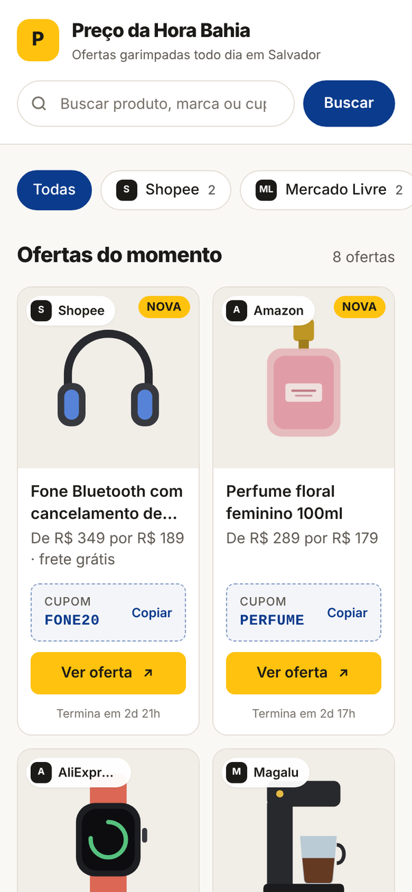
      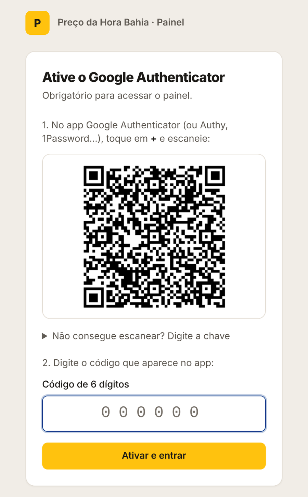
      <br><em>Barra inferior no celular e login protegido por 2FA obrigatório.</em>
    </td>
  </tr>
</table>

---

## 🌟 Recursos

### 1. 🛒 Vitrine pública
* **Home** com carrossel de banners, ofertas em destaque, categorias em círculos, novidades e faixa "somos uma página de afiliados".
* **Banners** de dois tipos: **texto** (título, destaque, subtítulo, botão, mascote e selos, com cor de fundo opcional) ou **arte pronta** (versão computador 1920×600 e celular 1080×1080, com link). Ordem, pausar, duplicar, **agendamento de início/fim** e tempo de troca, tudo pelo painel. Autoplay pausa no hover, aceita swipe e respeita "reduzir movimento".
* **Categorias com subcategorias** no menu, na lateral da listagem e em `/categorias`.
* **Listagem** (`/ofertas`) com busca, filtro por categoria e loja e ordenação: mais recentes, mais populares, maior desconto, menor e maior preço.
* **Card** com % de desconto, preço "de/por", cupom copiável, favorito e botão "Ver oferta" que vai direto à loja (`rel="sponsored"`).
* **Página da oferta** (`/oferta/<slug>`) com Open Graph para prévia no WhatsApp/Telegram, compartilhamento com texto pronto e ofertas relacionadas.
* **Favoritos** salvos no navegador do visitante, sem cadastro.
* **Expiração automática**: cada oferta vale 72h por padrão. Depois some da vitrine sozinha, sem cron.
* **Celular primeiro**: barra de navegação inferior, hero compacto e grade de 2 colunas.

### 2. 🔗 Links curtos e rastreamento de cliques
* Cada oferta ganha um endereço curto no seu domínio: `/fone-bluetooth-anc`.
* O clique é **gravado depois do redirecionamento** (`after()` do Next.js), então o visitante nunca espera o banco.
* **Redirecionamento 302**, e não 301, para que cliques repetidos sejam contados e trocar o link bruto tenha efeito imediato.
* **Não contam**: robôs, crawlers e prévias de link (WhatsApp, Telegram, Facebook) e *prefetch* do navegador.
* **LGPD**: o IP nunca é salvo, apenas um hash SHA-256 com sal, suficiente para contar visitantes únicos.

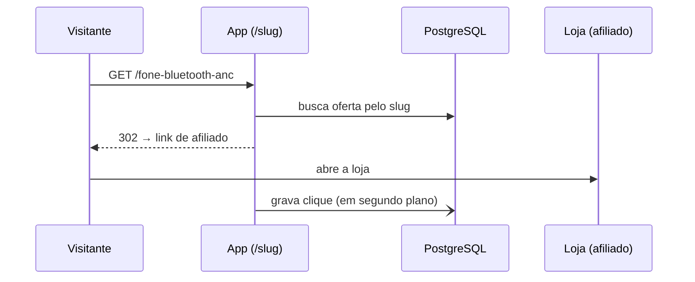

### 3. 🎨 White label de verdade
* Nome, slogan, logo, favicon, **cor primária**, **cor secundária**, hero, faixa de afiliados e rodapé salvos no banco.
* As cores viram variáveis CSS injetadas no `<html>` e o Tailwind usa essas variáveis (`bg-primary`, `text-secondary/80`…).
* **Contraste automático**: o sistema calcula se o texto sobre cada cor deve ser branco ou escuro, então qualquer cor escolhida continua legível.

### 4. 🔐 Painel administrativo seguro
* **2FA TOTP obrigatório** (Google Authenticator). Senha correta gera só um passe de 10 minutos; a sessão só existe depois do código.
* Segredo do autenticador **cifrado com AES-256-GCM** no banco.
* **Rate limit** em login e 2FA, senhas com bcrypt, cookies `httpOnly` + `SameSite`.
* **Cadastro fecha sozinho** depois do primeiro administrador.
* **Códigos de recuperação**: 10 códigos de uso único (guardados só como hash) para entrar se perder o celular.
* **Usuários e grupos**: Administrador, Moderador e Postador, com uma **matriz de permissões** onde o administrador marca quais páginas cada grupo vê. Criar, trocar grupo, resetar senha (temporária, com troca obrigatória), resetar 2FA e bloquear.
* **Meu perfil**: nome, e-mail, senha, códigos de recuperação, reconfigurar o Authenticator e sair dos outros dispositivos.
* Uploads validados pela **assinatura binária** do arquivo (não pelo nome), com SVG servido em *sandbox*.

### 5. 📊 Painel e analytics
* Cliques nas últimas 24h e 7 dias (com tendência), visitantes únicos e ofertas no ar.
* Gráfico de cliques por dia (14 dias) e ranking de ofertas.
* Ofertas com **destaque na home**, pausar, renovar, **duplicar**, categoria e preço "de/por" com desconto calculado.
* CRUD de **categorias** (2 níveis, com ícone) e de **plataformas**.

### 6. 🤖 Robô de ofertas
* Garimpa promoções no **Mercado Livre, Amazon e Shopee** e gera **os seus links de afiliado** (Linkbuilder do ML, tag da Amazon, Open API da Shopee).
* Chave de modo: **esteira de aprovação** (você aprova cada oferta) ou **publicar direto**.
* Ciclo configurável (padrão 45 min), ofertas por ciclo, desconto mínimo e máximo, faixa de preço, **palavras bloqueadas**, dias sem repetir o mesmo produto e horário de busca.
* Cada loja tem o seu **liga/desliga**, credenciais (segredos cifrados no banco) e botão **Testar busca**.
* **Nichos** (tecnologia, casa, games, moda…) que viram as categorias certas em cada loja.
* **Importar por link**: cole o link de um produto e ele entra na aprovação com foto, preço e link de afiliado.
* Login do Mercado Livre pelo próprio painel: o Chrome do robô abre no navegador (noVNC), com senha de uso único.

### 7. 🎟️ Cupons
* Página pública **/cupons** com os cupons válidos de cada loja, botão **Copiar** e link da loja com clique contado (`/c/<loja>`).
* **Importação por CSV** (`loja_id` e `codigo` obrigatórios; `descricao`, `validade`, `valor_minimo` opcionais), com modelo para baixar, **prévia** (novo, atualiza ou erro) antes de gravar e cadastro manual.
* Cada plataforma tem **banner de cupons** e **link de afiliado da loja**.
* Envio ao WhatsApp em **uma mensagem por loja** com todos os cupons, o banner e "Teste o cupom através deste link".

### 8. 🧩 Extensão do Chrome
* Com um produto aberto no **Mercado Livre, Amazon ou Shopee**, um clique no ícone abre o formulário já preenchido (título, foto, preço de/por, cupom).
* Gera o **seu link de afiliado**: Linkbuilder do ML com a sessão do próprio navegador, tag da Amazon, Open API da Shopee (ou cole o link).
* **Publicar agora** (com envio ao WhatsApp) ou **mandar para Aprovação**; avisa se o produto já foi publicado nos últimos 7 dias.
* Login com **e-mail, senha e 2FA**; a extensão guarda só uma chave daquele navegador, listada em **Meu perfil** com botão de desconectar.
* Baixe em **Meu perfil → Extensão do Chrome** (o .zip já vem com o endereço do seu site) e carregue em `chrome://extensions` → *Carregar sem compactação*.

### 9. 💬 WhatsApp (Evolution API)
* Envio ao grupo com **foto, preço de/por, desconto, cupom e o link curto** (os cliques contam no Analytics).
* **Fila com intervalo mínimo** entre mensagens para proteger o número; histórico com **reenviar**.
* Checkbox "Enviar ao grupo" ao publicar, botão de envio na lista de ofertas e na aprovação.
* **Vários grupos**, cada um marcado para receber **Ofertas** e/ou **Cupons**; verificar conexão, lista de grupos e mensagem de teste no painel.

---

## 🚀 Instalação (Portainer + OMV)

A imagem é compilada pelo GitHub Actions a cada push e publicada em `ghcr.io/jmarquesneto/ofertas_whitelabel:latest`, para **amd64 e arm64** (PC, mini PC ou Raspberry Pi). O seu servidor só baixa, sem compilar nada.

**1. Crie as pastas no OMV (SSH), num disco ext4 ou btrfs:**

```bash
DISCO=/srv/dev-disk-by-uuid-SEU-UUID
mkdir -p $DISCO/appdata/vitrine/{postgres,uploads,coletor}
id seu_usuario                # anote uid e gid → PUID e PGID
openssl rand -base64 48       # guarde: será o APP_SECRET
openssl rand -hex 32          # guarde: será o BOT_TOKEN
docker network create evolution_net   # só se você NÃO tiver a stack do Evolution
```

**2. No Portainer:** *Stacks → Add stack → Repository*

| Campo | Valor |
| :--- | :--- |
| Repository URL | `https://github.com/jmarquesneto/ofertas_whitelabel` |
| Repository reference | `refs/heads/main` |
| Compose path | `docker-compose.yml` |

**3. Environment variables** (*Advanced mode*, cole e ajuste):

```env
APPDATA_PATH=/srv/dev-disk-by-uuid-SEU-UUID/appdata/vitrine
PUID=1000
PGID=100
APP_PORT=3080
POSTGRES_PASSWORD=senha-forte-so-letras-e-numeros
APP_SECRET=resultado-do-openssl
BOT_TOKEN=resultado-do-openssl-hex
NOVNC_URL=http://IP-DO-OMV:6080
PUBLIC_URL=http://IP-DO-OMV:3080
COOKIE_SECURE=false
TZ=America/Bahia
```

**4. Deploy the stack** e acesse `http://IP-DO-OMV:3080/admin/register` para criar o administrador e ativar o 2FA.

> **Dica:** quando colocar um domínio com HTTPS (Nginx Proxy Manager, Traefik, Cloudflare Tunnel), troque `PUBLIC_URL` para o domínio e `COOKIE_SECURE=true`.

### ⚙️ Variáveis de ambiente

| Variável | Padrão | Para que serve |
| :--- | :---: | :--- |
| `APPDATA_PATH` | — | Pasta absoluta com `postgres/`, `uploads/` e `coletor/` (obrigatória) |
| `PUID` / `PGID` | `1000` / `100` | Usuário que roda o app e é dono de `uploads/` (o container ajusta as permissões ao iniciar) |
| `APP_PORT` | `3080` | Porta no host. Se estiver ocupada, troque só ela |
| `POSTGRES_PASSWORD` | — | Senha do banco (obrigatória) |
| `APP_SECRET` | — | Assina sessões e cifra o 2FA e os segredos das lojas e do WhatsApp, com 32+ caracteres (obrigatória, **não troque depois**) |
| `BOT_TOKEN` | — | Chave que o app e o coletor usam para conversar, 32+ caracteres (obrigatória) |
| `NOVNC_PORT` | `6080` | Porta do noVNC (login do Mercado Livre). Não encaminhe no roteador |
| `NOVNC_URL` | — | Endereço do noVNC na sua rede, ex.: `http://192.168.0.10:6080` |
| `EVOLUTION_NETWORK` | `evolution_net` | Rede da stack do Evolution API (WhatsApp) |
| `PUBLIC_URL` | `http://localhost:3080` | Endereço público, usado na prévia do link curto |
| `COOKIE_SECURE` | `true` | `false` só para testar sem HTTPS |
| `ALLOW_REGISTRATION` | `false` | `true` libera novos cadastros de administrador |
| `OFFER_DEFAULT_HOURS` | `72` | Validade padrão das ofertas |
| `UPLOAD_MAX_MB` | `8` | Tamanho máximo de imagens |
| `TZ` | `America/Bahia` | Fuso horário dos gráficos |

### 🔄 Atualizar

Depois de cada push na `main`, espere o selo **Docker image** ficar verde e, no Portainer, use **Pull and redeploy** com *Re-pull image* ligado. Banco e imagens ficam nas suas pastas, então nada se perde.

### 💾 Backup

```bash
docker exec vitrine-db pg_dump -U vitrine vitrine > backup-$(date +%F).sql
```

Ou copie a pasta `APPDATA_PATH` inteira com a stack parada.

---

## 🧱 Arquitetura

| Camada | Tecnologia | Por quê |
| :--- | :--- | :--- |
| App | **Next.js 15** (App Router, Server Actions) | Vitrine com SSR rápida para SEO e painel no mesmo container |
| Banco | **PostgreSQL 16** + **Drizzle ORM** | SQL tipado, migrações em SQL puro, sem binário extra na imagem |
| Estilo | **Tailwind CSS** + variáveis CSS, **Montserrat**, ícones **Lucide** | Cores da marca trocadas em tempo de execução |
| Auth | **jose** (JWT), **otplib** (TOTP), **bcrypt** | 2FA obrigatório e sessão verificada também no middleware |
| Deploy | **Docker** multi-stage, **GHCR**, **Portainer** | Imagem enxuta, usuário não-root, healthcheck e migrações automáticas no boot |

<details>
<summary><strong>📁 Estrutura de pastas</strong></summary>

```
├─ docker-compose.yml            # stack do Portainer (bind mounts absolutos)
├─ Dockerfile                    # multi-stage, Next standalone, não-root
├─ .github/workflows/docker.yml  # build amd64/arm64 → ghcr.io
├─ drizzle/                      # migrações SQL (aplicadas no boot)
└─ src/
   ├─ instrumentation*.ts        # boot: migrações + dados iniciais
   ├─ middleware.ts              # protege /admin/*
   ├─ db/schema.ts               # users, site_settings, platforms, offers, clicks
   ├─ lib/                       # auth, sessão, cripto, cores, slug, uploads
   ├─ server/actions/            # controllers: auth, settings, categories, platforms, offers
   ├─ server/queries.ts          # consultas da vitrine e do analytics
   ├─ app/(site)/                # vitrine: home, /ofertas, /oferta/[slug], /categorias, /favoritos
   ├─ app/[slug]/route.ts        # redirecionamento + registro do clique
   ├─ app/admin/                 # login, cadastro, 2FA e painel
   └─ components/                # public/ (vitrine), admin/ (painel), Icon.tsx (ícones)
```
</details>

<details>
<summary><strong>🗄️ Modelagem do banco</strong></summary>

| Tabela | Campos principais |
| :--- | :--- |
| `users` | e-mail único, hash bcrypt, grupo, bloqueado, troca de senha pendente, segredo TOTP cifrado, 2FA ativo, versão de sessão |
| `backup_codes` | usuário, hash HMAC do código de recuperação, usado em |
| `role_permissions` | grupo × página liberada (administrador vê tudo) |
| `site_settings` | linha única: nome, slogan, logo, favicon, cores hex (validadas no banco), hero, selos, faixa de afiliados, rodapé |
| `platforms` | nome, slug, logo, ativa, ordem |
| `banners` | tipo (texto/imagem), título, destaque, subtítulo, botão e link, imagens computador/celular, cor de fundo, ordem, ativo, início/fim |
| `categories` | nome, slug, ícone, categoria pai (2 níveis), ordem, ativa |
| `offers` | plataforma, categoria, título, preço, preço original, destaque, slug único, link de afiliado, cupom, imagem, expira em, cliques |
| `clicks` | oferta, hash do IP, user-agent, referer, data |
</details>

<details>
<summary><strong>🛠️ Desenvolvimento local</strong></summary>

```bash
git clone https://github.com/jmarquesneto/ofertas_whitelabel.git
cd ofertas_whitelabel
cp .env.example .env        # defina DATABASE_URL e UPLOAD_DIR=./uploads
npm install
npm run dev                 # migrações rodam sozinhas ao subir
npm run db:generate         # gera nova migração após alterar src/db/schema.ts
```
</details>

---

## 🗺️ Próximos passos

- [x] Categorias, preço "de/por", página da oferta e favoritos
- [x] Carrossel de banners com agendamento
- [x] Usuários, grupos com permissões por página, Meu perfil e códigos de recuperação do 2FA
- [x] Importar oferta a partir do link (título e imagem automáticos)
- [x] Robô de ofertas (ML, Amazon, Shopee) e postagem automática no WhatsApp
- [ ] Rate limit em Redis para múltiplas réplicas

---

## 📜 Licenciamento e Termos de Uso

Este projeto é de código aberto sob a licença **GNU Affero General Public License v3.0 (AGPLv3)**. O texto completo está em [`LICENSE`](LICENSE).

### 1. Uso livre (AGPLv3)
Você é totalmente livre para:
* Baixar, clonar e usar este software para fins **pessoais, educacionais, comunitários ou comerciais** sem pagar nada.
* Modificar o código-fonte para atender às suas necessidades.

Em troca, a AGPLv3 exige que você:
* **Mantenha os créditos** e os avisos de copyright e de licença do autor original.
* **Publique o código-fonte completo**, incluindo as suas modificações, sob a mesma licença AGPLv3, sempre que distribuir o software **ou oferecê-lo a terceiros pela internet** (por exemplo, como SaaS ou site hospedado para clientes).

### 2. Licença Comercial (para quem não quer abrir o código)
Se você quer usar este sistema em um **produto ou serviço fechado**, como revenda white label para clientes, SaaS proprietário ou integração em software comercial, **sem publicar o seu código-fonte** nos termos da AGPLv3, é necessária uma **Licença Comercial** separada, negociada diretamente com o autor.

* Para negociar termos comerciais, [abra uma issue](https://github.com/jmarquesneto/ofertas_whitelabel/issues) no repositório.

---

## ⚖️ Créditos

| Autor / Projeto | Contribuição | Link |
| :--- | :--- | :---: |
| **Marques Neto** | Idealização, desenvolvimento e manutenção do Ofertas White Label | [GitHub](https://github.com/jmarquesneto) |
| **Next.js** (Vercel) | Framework full-stack | [nextjs.org](https://nextjs.org) |
| **Drizzle ORM** | Camada de banco e migrações | [orm.drizzle.team](https://orm.drizzle.team) |
| **Tailwind CSS** | Sistema de estilos | [tailwindcss.com](https://tailwindcss.com) |
| **otplib** | Códigos TOTP do 2FA | [GitHub](https://github.com/yeojz/otplib) |
| **Bot de Ofertas para Telegram** (projeto público) | Base do coletor: busca nas lojas e geração de links de afiliado, adaptada para a vitrine e o WhatsApp | [coletor/](coletor/README.md) |
| **Evolution API** | Ponte com o WhatsApp | [GitHub](https://github.com/EvolutionAPI/evolution-api) |

<p align="center"><sub>As ilustrações de produtos das capturas de tela são fictícias, criadas só para demonstração. Marcas citadas pertencem aos seus donos.</sub></p>
